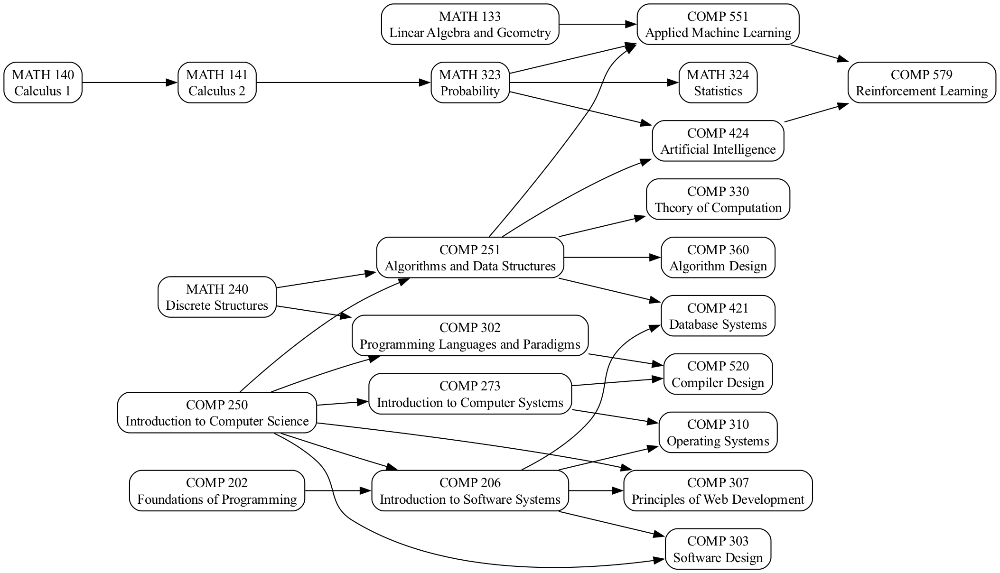

# McGill Course Planner

A command-line tool that models university course prerequisites as a graph and builds a
**term-by-term plan** to reach the courses you want, in the fewest terms it can find, while
respecting prerequisites, the terms each course is offered in, and a credit cap per term.

Built in plain Java 17 with no runtime dependencies. It started as a way to apply COMP 250
(data structures, Java) and COMP 251 (graphs, DFS, topological ordering) to a problem every
student has: *"in what order should I take these courses?"*

> **Heads up:** the bundled `courses.csv` is a small, **illustrative** sample. Prerequisites and
> terms offered are simplified and may be wrong or out of date. Always check the official McGill
> eCalendar. This project is not affiliated with or endorsed by McGill University.

## What it does
   
   

```text
$ java -jar target/course-planner.jar plan \
    --completed "COMP 202,COMP 250,COMP 251,MATH 133,MATH 140,MATH 240" \
    --goal "COMP 551,COMP 579" --start winter-2027

Plan from Winter 2027, at most 15 credits per term

Winter 2027  (4 credits)
  MATH 141  Calculus 2                                 4 cr

Fall 2027  (3 credits)
  MATH 323  Probability                                3 cr

Winter 2028  (4 credits)
  COMP 551  Applied Machine Learning                   4 cr

Winter 2029  (4 credits)
  COMP 579  Reinforcement Learning                     4 cr

15 credits in 4 terms, finishing in Winter 2029.
```

Notice that COMP 579 lands in Winter 2029: it only runs in winter and needs COMP 551 finished
first. Also notice that it picked COMP 551 from the "COMP 424 **or** COMP 551" prerequisite
because COMP 551 was already a goal, so it did not add a needless extra course.

Other commands:

| Command | What it does |
|---|---|
| `list` | Show every course, its credits, terms offered and prerequisites |
| `check` | Validate a catalog: detect prerequisite **cycles** and prerequisites that name unknown courses |
| `prereqs "COMP 579"` | Print the full prerequisite tree of a course |
| `plan --goal A,B [--completed X,Y] [--start fall-2026] [--max-credits 15]` | Build a term-by-term plan |
| `dot` | Export the prerequisite graph as Graphviz DOT (`... dot \| dot -Tpng -o graph.png`) |

Use `--catalog my-courses.csv` with any command to load your own data.

## Quick start

Requires JDK 17+ and Maven.

```bash
mvn verify                      # compile + run the unit tests, builds target/course-planner.jar
java -jar target/course-planner.jar help
java -jar target/course-planner.jar check
java -jar target/course-planner.jar plan --goal "COMP 520" --max-credits 6 --start fall-2026
```

No Maven? The code has no dependencies, so plain `javac` works too:

```bash
javac -d out src/main/java/courseplanner/*.java
java -cp out:src/main/resources courseplanner.Main check      # use ';' instead of ':' on Windows
```

## How it works

### 1. Parsing prerequisites

A prerequisite such as `COMP 251 and (MATH 323 or MATH 324)` is parsed by a small
**recursive-descent parser** into a tree (`Requirement`: `Needs`, `AllOf`, `AnyOf`, `None`).

```
expr := term ( "or" term )*
term := atom ( "and" atom )*
atom := COURSE | "(" expr ")"
```

`and` binds tighter than `or`, as in boolean algebra. This matters because a real prerequisite
graph is **not a plain DAG**: an OR node means "pick one of these", so the planner has to make
choices.

### 2. Validating the graph

Edges run from each course to every course in its prerequisite expression. `Catalog.findCycle()`
runs a depth-first search that colours each course *unvisited / in progress / done*. Reaching an
"in progress" course again closes a cycle, which is reported as a readable path. O(V + E).

```
$ java -jar target/course-planner.jar check --catalog broken.csv
Prerequisite cycle (each course requires the next): COMP 100 -> COMP 101 -> COMP 100
```

### 3. Resolving what is still needed

Starting from the goals, the planner walks the prerequisite trees backwards and collects every
course not yet completed. At an OR node it tries each alternative and keeps the **cheapest**:
fewest extra courses, counting courses that are already needed for another goal as free, and
treating a prerequisite that is missing from the catalog as very expensive.

### 4. Scheduling into terms

Terms are filled in order (Fall → Winter → Fall ...). A course is *eligible* in a term when

- all its prerequisites were completed in an **earlier** term (never the same term), and
- it is offered in that term's season.

If more courses are eligible than fit under the credit cap, those that unlock the **longest chain**
of later required courses go first. This is *critical-path list scheduling*, a standard heuristic
for scheduling under precedence constraints. In the example above it is why `COMP 250` and
`MATH 240` (start of a long chain) are chosen before an unrelated short-chain course when space is tight.

The planner stops if two consecutive terms (one Fall, one Winter) place nothing, because the
state can never change after that, and reports whatever was left over instead of looping.

## Catalog format

A CSV file: `code,title,credits,offered,prereq`

```csv
code,title,credits,offered,prereq
COMP 250,Introduction to Computer Science,3,FW,
COMP 251,Algorithms and Data Structures,3,FW,COMP 250 and MATH 240
COMP 579,Reinforcement Learning,4,W,COMP 424 or COMP 551
```

`offered` is `F`, `W` or `FW`. Blank lines and lines starting with `#` are ignored. Quote the
prerequisite field if it ever contains a comma.

## Project layout

```
src/main/java/courseplanner/
  Requirement.java        sealed interface + records: the AND/OR prerequisite tree
  RequirementParser.java  recursive-descent parser for prerequisite text
  Course.java, Season.java, Term.java
  Catalog.java            CSV loading, cycle detection, unknown-course check
  Planner.java            resolve what's needed, then schedule it into terms
  Main.java               the command-line interface
src/main/resources/courses.csv   sample catalog
src/test/java/courseplanner/     JUnit 5 tests for each class + the CLI
.github/workflows/ci.yml         builds and tests on every push
```

## Design notes and limitations

- **The schedule is a heuristic, not a proven optimum.** Minimising the number of terms under a
  credit cap is a hard scheduling problem; putting long chains first gives good plans in practice
  but is not guaranteed minimal.
- **OR choices are greedy.** Each OR node is resolved locally to its cheapest alternative. Deeply
  nested ORs could in principle pick a locally cheap but globally worse option, and resolving them
  can blow up exponentially on pathological input (real prerequisites are tiny).
- **Not modelled yet:** corequisites, summer terms, "minimum grade" rules, "N credits from this
  list" program requirements, and offerings that change from year to year.
- The sample data is hand-written. Importing the real catalog is on the roadmap.

## Roadmap

- [x] Prerequisite expression parser (AND / OR / parentheses) with tests
- [x] Cycle detection and unknown-course validation
- [x] Term-by-term planner with credit cap and term-offering rules
- [x] CLI, Graphviz export, CI
- [ ] Corequisites and summer terms
- [ ] Program requirements ("12 credits from this list of electives")
- [ ] Compare the heuristic against an exact solver (branch-and-bound) on small catalogs
- [ ] Catalog importer for real course data (respecting the source's terms of use)
- [ ] Small web UI: pick completed courses and a goal, see the graph and the plan
